import useBaseUrl from '@docusaurus/useBaseUrl';

# AI Ecosystem: Multi-Lens Architecture & Governance

Welcome to Sezoo's **AI Ecosystem Model**. 

This model provides a holistic conceptual map of how the global AI ecosystem operates, bringing together:
- **Macroeconomics & Capital Flows:** How venture subsidies, CapEx, token fees, and SaaS pricing interact.
- **Cybernetic Governance:** How deterministic policy harnesses (Beer's Viable System Model) constrain non-deterministic probabilistic models.
- **Statutory Liability:** How the regulatory initiatives such as the EU AI Act and legal frameworks such as "common law" assign vicarious liability across deployers, foundation labs, and end users.

Explore the unified architecture below, query individual components via the data dictionary, or dive into specific competency questions in our **[Sense-Making Inquiries](/inquiries)** catalog.

:::tip Download Canonical Models
Download the raw model to query in external visual modeling tools:

- <a href={useBaseUrl("/exports/ai_ecosystem.graphml")} download="ai_ecosystem.graphml">**Download for yEd** (.graphml)</a>
- <a href={useBaseUrl("/exports/ai_ecosystem.drawio")} download="ai_ecosystem.drawio">**Download for draw.io** (.drawio)</a>
- <a href={useBaseUrl("/exports/ai_ecosystem_kumu.json")} download="ai_ecosystem_kumu.json">**Download for Kumu Blueprint** (.json)</a>
:::

```mermaid
flowchart LR
    classDef gov fill:#FFF1F0,stroke:#F5222D,stroke-width:2px;
    classDef econ fill:#F6FFED,stroke:#52C41A,stroke-width:2px;
    classDef tech fill:#E6F7FF,stroke:#1890FF,stroke-width:2px;
    classDef default fill:#F8FAFC,stroke:#64748B,stroke-width:1.5px;

    subgraph LegendShapes ["Architectural Node Archetypes"]
        K_HEX{{"Statutory Authority<br/><small><i>kind: StatutoryAuthority</i></small>"}}:::gov
        K_STA_STD(["Standards Consortium<br/><small><i>kind: StandardsConsortium</i></small>"]):::gov
        K_SUB_FOR[["Foresight Institute<br/><small><i>kind: ForesightInstitute</i></small>"]]:::gov
        K_CIR(("Natural Person<br/><small><i>kind: NaturalPerson</i></small>")):::gov
        K_SUB[["Deterministic Gate<br/><small><i>kind: DeterministicGate</i></small>"]]:::tech
        K_CYL[("State Store<br/><small><i>kind: StateStore</i></small>")]:::tech
        K_STA(["Security Authority<br/><small><i>kind: SecurityAuthority</i></small>"]):::tech
        K_RND("Software Service<br/><small><i>kind: SoftwareService</i></small>"):::tech
        K_REC["Economic Entity<br/><small><i>kind: EconomicEntity</i></small>"]:::econ
    end
```

<strong>📖 Visual Language & Architectural Key (Click to expand)</strong>

### Node Archetypes (Kinds)

| Kind | Semantic Meaning | Visual Shape |
| :--- | :--- | :---: |
| `StatutoryAuthority` | Non-negotiable legal authorities, courts, market surveillance | `hexagon` |
| `StandardsConsortium` | International technical standards bodies (ISO/IEC JTC 1/SC 42, NIST, CEN) | `stadium` |
| `ForesightInstitute` | National AI Safety Institutes (US/UK/Japan AISI), frontier red-team evaluators | `subproc` |
| `NaturalPerson` | Human delegators, mandatory Art. 14 supervisors, impacted third parties | `circle` |
| `DeterministicGate` | Sandboxes, policy harnesses, capability brokers bounding non-deterministic AI | `subproc` |
| `StateStore` | WORM audit ledgers, vector databases, operational enterprise ERPs | `cylinder` |
| `SecurityAuthority` | Enterprise IdP, OAuth token issuers, workload authorization brokers | `stadium` |
| `SoftwareService` | Foundation model endpoints, vertical applications, continuous eval engines | `rounded` |
| `EconomicEntity` | Commercial deployers, compute hubs, cloud platforms, capital funds, energy grids | `rect` |

### Relationship & Edge Types

| Line Style | Semantic Relation Kind | Description |
| :---: | :--- | :--- |
| `== '🚨 label' ==>` | `algedonic_signal` | **VSM Emergency Tripwire:** Direct crisis bypass from S1 operations to S5 board/policy |
| `== 'label' ==>` | `commercial_flow` | Capital transactions, SaaS fees, token costs, insurance premiums |
| `== 'label' ==>` | `statutory_mandate` | Statutory orders, compliance mandates, mandatory oversight |
| `-. 'label' .->` | `governance_control` | Policy bounds, audit trail logging, S3* independent sampling probes |
| `-. 'label' .->` | `liability_exposure` | Real-world tort liability, blast radius causation, direct civil exposure |
| `-. 'label' .->` | `competitive_pressure` | Market margin compression, platform absorption, open-weight price deflation |
| `-. 'label' .->` | `physical_constraint` | Hard physical limits: power grid capacity, transformer delays, fab throughput |
| `-. 'label' .->` | `contractual_term` | Contractual liability carve-outs, ToS 'AS-IS' disclaimers |
| `-->|'label'|` | `protocol_call` | Technical protocols (A2E, MIP, A2T via MCP, A2A) |
| `-->|'label'|` | `data_flow` | Telemetry traces, prompt context (RAG), model weights, evidence logs |

### Market Dynamics: Wardley Stages, Power Asymmetry & Switching Costs

| Property | Values | Semantic Meaning |
| :--- | :--- | :--- |
| **`evolution_stage`** | `genesis` | Novel, experimental, unproven concepts with high uncertainty |
| | `custom_built` | Bespoke, highly differentiated implementations or rare capital assets (e.g. ASML lithography) |
| | `product` | Standardized, commercialized off-the-shelf software or hardware products |
| | `commodity` | Ubiquitous, standardized utility or open commons (zero-marginal cost) |
| **`power_asymmetry`** | `supplier_dominant` | Supplier dictates pricing, access, and terms (seller's market) |
| | `buyer_dominant` | Buyer dictates terms and performance specifications (buyer's market) |
| | `balanced` | Bilateral commercial parity |
| | `captive` | Downstream participant is structurally trapped with near-zero alternative options |
| **`switching_cost`** | `prohibitive` | Switching requires full architectural, physical, or legal refactoring |
| | `high` | Switching requires extensive re-indexing, prompt re-tuning, and workflow rebuilding |
| | `moderate` | Standard multi-cloud or modular API adaptation effort |
| | `low` | Commoditized, drop-in replacement (e.g. OpenAI-compatible open-weight endpoints) |

## Unified Ecosystem Architecture

```mermaid
flowchart TB
    classDef gov fill:#FFF1F0,stroke:#F5222D,stroke-width:2px;
    classDef econ fill:#F6FFED,stroke:#52C41A,stroke-width:2px;
    classDef tech fill:#E6F7FF,stroke:#1890FF,stroke-width:2px;
    classDef default fill:#F8FAFC,stroke:#64748B,stroke-width:1.5px;

    subgraph cluster_regulatory ["0. Jurisdictional, Capital & Regulatory Sphere"]
        N_REGULATOR{{"Market Surveillance &amp; Trade Authorities<br/><small><i>EU AI Office, FTC, BIS Export Controls, DPAs, Courts</i></small>"}}:::gov
        N_STANDARDS_BODY(["Standards Setting Organizations<br/><small><i>ISO/IEC JTC 1/SC 42, NIST, CEN-CENELEC, IEEE</i></small>"]):::gov
        N_SAFETY_INSTITUTE[["AI Safety &amp; Horizon Institutes<br/><small><i>US AISI, UK AISI, Japan AISI, Frontier Evaluators</i></small>"]]:::gov
        N_AUDITOR{{"Conformity Body &amp; ISO Auditor<br/><small><i>Notified Bodies, ISO/IEC 42001 Certifiers</i></small>"}}:::gov
        N_INSURER["AI Risk Underwriter &amp; Insurer<br/><small><i>Algorithmic Liability &amp; Cyber Risk Carrier</i></small>"]:::gov
        N_CAPITAL["Capital Markets &amp; Venture Underwriters<br/><small><i>VC Syndicates, Hyperscaler Equity &amp; Sovereign Wealth</i></small>"]:::econ
    end

    subgraph cluster_supply ["1. Upstream Foundation, Silicon & Cloud Supply"]
        N_SILICON_CHOKEPOINT["Leading-Edge Silicon &amp; Lithography<br/><small><i>ASML (EUV), TSMC (Foundry), Nvidia, HBM Memory</i></small>"]:::econ
        N_ENERGY_GRID["Energy Grids &amp; Power Generation<br/><small><i>Nuclear PPAs, Substation Transformers, Cooling</i></small>"]:::econ
        N_TRAIN["Training Compute Campuses<br/><small><i>Mega-Data Centers, GW-Scale Cluster Fabric, Power Sub-stations</i></small>"]:::econ
        N_CLOUD_HYPERSCALER["Hyperscaler Cloud Platform<br/><small><i>Microsoft Azure, AWS, Google Cloud, OCI</i></small>"]:::econ
        N_FRONTIER("Frontier Foundation Model<br/><small><i>Globally Replicated Weights &amp; Inference Fleets</i></small>"):::gov
        N_OPEN_MODEL("Open-Weight Model Commons<br/><small><i>Commoditized Weights, Distilled Checkpoints &amp; Local Runtimes</i></small>"):::econ
        N_ABSORBED["Platform Absorption Zone<br/><small><i>Native Tools, Prompt Cache, Hosted State (a16z Stack)</i></small>"]:::econ
    end

    subgraph cluster_product ["2. Specialized Product & Harness Domain (ISV / Custom Runtime)"]
        N_ISV_PRODUCT("Specialized AI Application<br/><small><i>Vertical Solutions (Legal, Medical, Finance, Ops)</i></small>"):::econ
        N_HARNESS[["Autonomous Agent Runtime (The Harness)<br/><small><i>Execution Loop, Planning, Rights &amp; Guardrails</i></small>"]]:::gov
        N_AUDIT_STORE[("Sovereign Audit Ledger<br/><small><i>Tamper-Evident WORM State &amp; Forensic Store</i></small>")]:::gov
        N_OBSERVE("Observability &amp; Evals Engine<br/><small><i>Continuous Evaluation, Traces &amp; Cost Telemetry</i></small>"):::gov
    end

    subgraph cluster_client ["3. Enterprise Deployer & Principal Domain"]
        N_ENTERPRISE["Enterprise Deployer<br/><small><i>Legal Principal &amp; Economic Sponsor</i></small>"]:::gov
        N_IDP(["Enterprise Identity &amp; Auth (IdP)<br/><small><i>OAuth, OIDC, Workload IAM &amp; Ephemeral Tokens</i></small>"]):::gov
        N_KNOWLEDGE_STORE[("Enterprise Semantic Knowledge Base<br/><small><i>Proprietary Vector DBs, Documents &amp; Embeddings</i></small>")]:::gov
        N_HUMAN_USER(("Human Task Delegator &amp; Overseer<br/><small><i>End User / Mandatory HITL Supervisor</i></small>")):::gov
    end

    subgraph cluster_environment ["4. Target Execution Environment & Blast Radius"]
        N_TOOL_GATEWAY[["Capability &amp; Tool Gateway<br/><small><i>Decoupled Tool Broker &amp; Context Provider (MCP)</i></small>"]]:::gov
        N_TARGET_SYS[("Target Systems &amp; Operational APIs<br/><small><i>Databases, Production ERP, Financial Rails</i></small>")]:::gov
        N_AFFECTED_PARTY(("Impacted Third Party<br/><small><i>Consumers, Employees, Citizens</i></small>")):::gov
    end

    N_CAPITAL == "$$$ Fab CapEx & Lithography Tool Procurement" ==> N_SILICON_CHOKEPOINT
    N_CAPITAL == "$$$ Clean Energy PPAs & Grid Upgrades" ==> N_ENERGY_GRID
    N_REGULATOR == "Export Controls, Entity List & Technology Sanctions" ==> N_SILICON_CHOKEPOINT
    N_SILICON_CHOKEPOINT -->|"Leading-Edge GPU Allocation & Advanced Packaging (CoWoS)"| N_TRAIN
    N_ENERGY_GRID -. "Physical GW Power & Transformer Bottleneck" .-> N_TRAIN
    N_TRAIN == "Compute Cluster Hosting & Bare-Metal Capacity" ==> N_CLOUD_HYPERSCALER
    N_CLOUD_HYPERSCALER -->|"Hyperscale Inference Fleet Orchestration"| N_FRONTIER
    N_SAFETY_INSTITUTE -. "Pre-Deployment Evaluations & Systemic Risk Alerts (Macro S4 to S5)" .-> N_REGULATOR
    N_STANDARDS_BODY -. "Harmonized Standards & Audit Specifications (ISO 42001 / CEN)" .-> N_AUDITOR
    N_STANDARDS_BODY -. "Technical Control Standards & Interoperability Profiles" .-> N_HARNESS
    N_FRONTIER -->|"Pre-Release Model Weight Access for National Security Red-Teaming"| N_SAFETY_INSTITUTE
    N_CAPITAL == "$$$ Equity Subsidies & Compute Credits" ==> N_FRONTIER
    N_CAPITAL == "$$$ CapEx Infrastructure Project Debt & Equity" ==> N_TRAIN
    N_ENTERPRISE == "$$$ Cloud Spend Commitments (MACC) & Enterprise Tenancy" ==> N_CLOUD_HYPERSCALER
    N_ENTERPRISE == "$$$ SaaS Subscription / Outcome Fee" ==> N_ISV_PRODUCT
    N_ISV_PRODUCT == "$$ Wholesale Token Consumption Cost" ==> N_FRONTIER
    N_FRONTIER == "$ Compute CapEx & Annotation" ==> N_TRAIN
    N_ENTERPRISE == "$ Policy Premiums & Risk Transfer" ==> N_INSURER
    N_ABSORBED -. "Platform Commoditization Pressure (a16z Stack)" .-> N_ISV_PRODUCT
    N_TRAIN -->|"Sunk-Cost Open Weights Release"| N_OPEN_MODEL
    N_OPEN_MODEL -. "Inference Price Deflation & Compression" .-> N_FRONTIER
    N_REGULATOR == "Statutory Penalties & Enforcement (Art. 99)" ==> N_ENTERPRISE
    N_REGULATOR == "GPAI Codes of Practice & Transparency (Art. 53/101)" ==> N_FRONTIER
    N_REGULATOR == "High-Risk System Compliance & Surveillance (Art. 9/43)" ==> N_ISV_PRODUCT
    N_AUDITOR == "Conformity Audits (ISO 42001 / High Risk)" ==> N_ENTERPRISE
    N_FRONTIER -. "Disclaims Liability (ToS 'AS-IS' / Recourse Gap)" .-> N_ENTERPRISE
    N_ENTERPRISE -. "Vicarious Liability for Harm (Respondeat Superior)" .-> N_AFFECTED_PARTY
    N_AFFECTED_PARTY -->|"Complaints & Redress Demands (Art. 85)"| N_REGULATOR
    N_AFFECTED_PARTY -. "Market Resistance, Consumer Churn & Social License Revocation" .-> N_ENTERPRISE
    N_ENTERPRISE -. "Delegates Authority & Safety Boundaries (VSM 5 to 3)" .-> N_HARNESS
    N_HUMAN_USER -. "Art. 14 Human Oversight & Kill Switch" .-> N_HARNESS
    N_HARNESS -. "Cryptographic Tamper-Proof Audit Trail (Art. 12)" .-> N_AUDIT_STORE
    N_AUDIT_STORE -->|"Forensic Evidence for Compliance Verification"| N_AUDITOR
    N_HARNESS -. "Enforces Least-Privilege Scopes (VSM 3 to 2)" .-> N_TOOL_GATEWAY
    N_TARGET_SYS -. "Direct Impact & Real-World Blast Radius" .-> N_AFFECTED_PARTY
    N_OBSERVE -. "VSM S3* Independent Behavioral Probe & Red-Teaming" .-> N_TARGET_SYS
    N_TARGET_SYS == "🚨 VSM Algedonic Alarm (Direct S1 to S5 Circuit Breaker)" ==> N_ENTERPRISE
    N_HUMAN_USER -->|"Prompt Intent & Working Context"| N_ISV_PRODUCT
    N_IDP -->|"A2E Workload Identity Delegation (OAuth/OIDC)"| N_HARNESS
    N_ISV_PRODUCT -->|"Initiates Autonomous Loop"| N_HARNESS
    N_HARNESS -->|"MIP Inference API (Tokens & Directives)"| N_FRONTIER
    N_HARNESS -->|"RAG Semantic Retrieval & Working Context (CoALA)"| N_KNOWLEDGE_STORE
    N_HARNESS -->|"A2A Multi-Agent Delegation & Peer Protocol"| N_HARNESS
    N_HARNESS -->|"Traces & LLM Evaluation Metrics"| N_OBSERVE
    N_OBSERVE -->|"Real-time Cost & Token Telemetry"| N_ENTERPRISE
    N_HARNESS -->|"A2T Tool Calling & Context Protocol (MCP / OpenAPI)"| N_TOOL_GATEWAY
    N_TOOL_GATEWAY -->|"Authenticated Operations Execution (VSM System 1)"| N_TARGET_SYS
    N_ISV_PRODUCT -->|"Self-Hosted / Private Inference (Zero Token Toll)"| N_OPEN_MODEL
```

## Canonical Element Dictionary

| Element | Cluster | Kind | Wardley Evolution | VSM Tier & Recursion | Ashby Variety | Jurisdiction | EU AI Act Role |
| :--- | :--- | :--- | :--- | :--- | :--- | :--- | :--- |
| **Market Surveillance & Trade Authorities** <small>EU AI Office, FTC, BIS Export Controls, DPAs, Courts</small> `N_REGULATOR` | 0. Jurisdictional, Capital & Regulatory Sphere | `StatutoryAuthority` | `product` | `S5_Policy` <small>Level_n_plus_1_Jurisdiction</small> | 10^1–10^2 jurisdictions | `Multi_Jurisdictional` | `—` |
| **Standards Setting Organizations** <small>ISO/IEC JTC 1/SC 42, NIST, CEN-CENELEC, IEEE</small> `N_STANDARDS_BODY` | 0. Jurisdictional, Capital & Regulatory Sphere | `StandardsConsortium` | `commodity` | `S2_Coordination` <small>Level_n_plus_1_Jurisdiction</small> | 10^1–10^1.5 entities | `Global` | `—` |
| **AI Safety & Horizon Institutes** <small>US AISI, UK AISI, Japan AISI, Frontier Evaluators</small> `N_SAFETY_INSTITUTE` | 0. Jurisdictional, Capital & Regulatory Sphere | `ForesightInstitute` | `custom_built` | `S4_Intelligence` <small>Level_n_plus_1_Jurisdiction</small> | 10^1–10^1.5 entities | `Multi_Jurisdictional` | `—` |
| **Conformity Body & ISO Auditor** <small>Notified Bodies, ISO/IEC 42001 Certifiers</small> `N_AUDITOR` | 0. Jurisdictional, Capital & Regulatory Sphere | `StatutoryAuthority` | `product` | `S3_Star_Audit` <small>Level_n_plus_1_Jurisdiction</small> | 10^2–10^3 entities | `Multi_Jurisdictional` | `—` |
| **AI Risk Underwriter & Insurer** <small>Algorithmic Liability & Cyber Risk Carrier</small> `N_INSURER` | 0. Jurisdictional, Capital & Regulatory Sphere | `EconomicEntity` | `product` | `S3_Control` <small>Level_n_plus_1_Jurisdiction</small> | 10^2–10^3 entities | `Global` | `—` |
| **Capital Markets & Venture Underwriters** <small>VC Syndicates, Hyperscaler Equity & Sovereign Wealth</small> `N_CAPITAL` | 0. Jurisdictional, Capital & Regulatory Sphere | `EconomicEntity` | `commodity` | — | 10^2–10^3 entities | `Global` | `—` |
| **Leading-Edge Silicon & Lithography** <small>ASML (EUV), TSMC (Foundry), Nvidia, HBM Memory</small> `N_SILICON_CHOKEPOINT` | 1. Upstream Foundation, Silicon & Cloud Supply | `EconomicEntity` | `custom_built` | — | 10^0–10^1 entities | `Global` | `—` |
| **Energy Grids & Power Generation** <small>Nuclear PPAs, Substation Transformers, Cooling</small> `N_ENERGY_GRID` | 1. Upstream Foundation, Silicon & Cloud Supply | `EconomicEntity` | `commodity` | — | 10^2–10^3 entities | `Multi_Jurisdictional` | `—` |
| **Training Compute Campuses** <small>Mega-Data Centers, GW-Scale Cluster Fabric, Power Sub-stations</small> `N_TRAIN` | 1. Upstream Foundation, Silicon & Cloud Supply | `EconomicEntity` | `product` | — | 10^1–10^1.3 clusters | `Global` | `—` |
| **Hyperscaler Cloud Platform** <small>Microsoft Azure, AWS, Google Cloud, OCI</small> `N_CLOUD_HYPERSCALER` | 1. Upstream Foundation, Silicon & Cloud Supply | `EconomicEntity` | `commodity` | — | 10^0.5–10^0.8 entities | `Global` | `—` |
| **Frontier Foundation Model** <small>Globally Replicated Weights & Inference Fleets</small> `N_FRONTIER` | 1. Upstream Foundation, Silicon & Cloud Supply | `SoftwareService` | `product` | `S1_Operations` <small>Level_n_Enterprise</small> | 10^1–10^1.3 entities | `Global` | `Provider_GPAI` |
| **Open-Weight Model Commons** <small>Commoditized Weights, Distilled Checkpoints & Local Runtimes</small> `N_OPEN_MODEL` | 1. Upstream Foundation, Silicon & Cloud Supply | `SoftwareService` | `commodity` | — | 10^2–10^3 instances | `Global` | `Provider_GPAI` |
| **Platform Absorption Zone** <small>Native Tools, Prompt Cache, Hosted State (a16z Stack)</small> `N_ABSORBED` | 1. Upstream Foundation, Silicon & Cloud Supply | `EconomicEntity` | `commodity` | — | 10^0.5–10^0.8 entities | `Global` | `—` |
| **Specialized AI Application** <small>Vertical Solutions (Legal, Medical, Finance, Ops)</small> `N_ISV_PRODUCT` | 2. Specialized Product & Harness Domain (ISV / Custom Runtime) | `SoftwareService` | `product` | — | 10^4–10^5 instances | `Global` | `Provider_System` |
| **Autonomous Agent Runtime (The Harness)** <small>Execution Loop, Planning, Rights & Guardrails</small> `N_HARNESS` | 2. Specialized Product & Harness Domain (ISV / Custom Runtime) | `DeterministicGate` | `product` | `S3_Control` <small>Level_n_Enterprise</small> | 10^7–10^9 invocations_per_year | `Global` | `—` |
| **Sovereign Audit Ledger** <small>Tamper-Evident WORM State & Forensic Store</small> `N_AUDIT_STORE` | 2. Specialized Product & Harness Domain (ISV / Custom Runtime) | `StateStore` | `product` | `S3_Control` <small>Level_n_Enterprise</small> | 10^4–10^5 instances | `Global` | `—` |
| **Observability & Evals Engine** <small>Continuous Evaluation, Traces & Cost Telemetry</small> `N_OBSERVE` | 2. Specialized Product & Harness Domain (ISV / Custom Runtime) | `SoftwareService` | `product` | `S3_Star_Audit` <small>Level_n_Enterprise</small> | 10^4–10^5 instances | `Global` | `—` |
| **Enterprise Deployer** <small>Legal Principal & Economic Sponsor</small> `N_ENTERPRISE` | 3. Enterprise Deployer & Principal Domain | `EconomicEntity` | `custom_built` | `S5_Policy` <small>Level_n_Enterprise</small> | 10^5–10^6 entities | `Multi_Jurisdictional` | `Deployer` |
| **Enterprise Identity & Auth (IdP)** <small>OAuth, OIDC, Workload IAM & Ephemeral Tokens</small> `N_IDP` | 3. Enterprise Deployer & Principal Domain | `SecurityAuthority` | `commodity` | `S2_Coordination` <small>Level_n_Enterprise</small> | 10^5–10^6 instances | `Global` | `—` |
| **Enterprise Semantic Knowledge Base** <small>Proprietary Vector DBs, Documents & Embeddings</small> `N_KNOWLEDGE_STORE` | 3. Enterprise Deployer & Principal Domain | `StateStore` | `custom_built` | `S1_Operations` <small>Level_n_Enterprise</small> | 10^5–10^6 instances | `Global` | `—` |
| **Human Task Delegator & Overseer** <small>End User / Mandatory HITL Supervisor</small> `N_HUMAN_USER` | 3. Enterprise Deployer & Principal Domain | `NaturalPerson` | `custom_built` | `S5_Policy` <small>Level_n_Enterprise</small> | 10^7–10^8.5 natural_persons | `Global` | `—` |
| **Capability & Tool Gateway** <small>Decoupled Tool Broker & Context Provider (MCP)</small> `N_TOOL_GATEWAY` | 4. Target Execution Environment & Blast Radius | `DeterministicGate` | `product` | `S2_Coordination` <small>Level_n_Enterprise</small> | 10^4–10^5 instances | `Global` | `—` |
| **Target Systems & Operational APIs** <small>Databases, Production ERP, Financial Rails</small> `N_TARGET_SYS` | 4. Target Execution Environment & Blast Radius | `StateStore` | `custom_built` | `S1_Operations` <small>Level_n_Enterprise</small> | 10^6–10^7 instances | `Global` | `—` |
| **Impacted Third Party** <small>Consumers, Employees, Citizens</small> `N_AFFECTED_PARTY` | 4. Target Execution Environment & Blast Radius | `NaturalPerson` | `custom_built` | — | 10^9–10^10 natural_persons | `Global` | `Affected_Subject` |