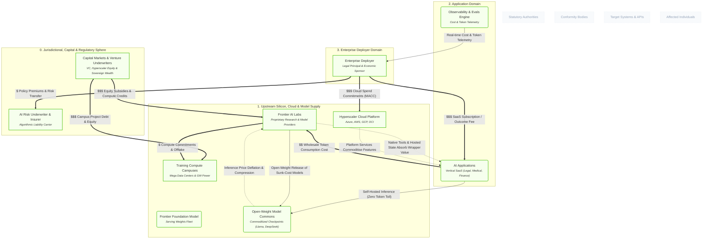

# Understanding AI Economics: Valuations, Corporate Structures, and Revenue Flows

## 1. Executive Summary & Core Thesis
Value in the AI ecosystem does not pool evenly; it behaves as an **asymmetric capital siphon** caught between heavy upstream CapEx and an enterprise return-on-investment (ROI) hurdle. 

The canonical model illustrates that:
1. **Upstream Labs & Infrastructure** survive on a mix of wholesale token tolls and massive **equity subsidies from capital markets** to offset multi-gigawatt compute commitments.
2. **Specialized Vertical ISVs** face a structural **"SaaS Margin Sandwich"**—squeezed between variable token COGS below and fixed SaaS pricing expectations above, while cloud platforms continually threaten to absorb their features.
3. **Open-Weight Commons** act as a critical macroeconomic deflationary force, depressing the pricing power of proprietary frontier labs and offering ISVs an architectural escape hatch from the per-token toll.

---

## 2. Model Perspective

The diagram below isolates the economic flows and competitive tensions across the five system tiers:

## 3. Systemic Mechanics & Walkthrough

### 1. The Commercial Revenue Waterfall

In a normalized software economy, revenue flows up from the buyer to the application, which passes margin down to suppliers. In the AI ecosystem, this waterfall has distinct friction points:

1. **Enterprise Deployment (N_ENTERPRISE → N_ISV_PRODUCT):** The enterprise deploys capital via traditional SaaS recurring fees or outcome-based contracts, under strict ROI payback pressure.

2. **Wholesale Token Toll (N_ISV_PRODUCT → N_FRONTIER_LAB):** Unlike traditional software where hosting represents 5–15% of revenue, vertical AI ISVs face variable marginal inference costs that scale with customer usage, degrading gross margins.

3. **CapEx Commitments (N_FRONTIER_LAB → N_TRAIN):** Foundation labs channel their token revenues directly into massive, multi-year compute offtake agreements.

### 2. The Equity Bridge & The Capital-Compute Flywheel (L_R1)

Commercial revenues alone do not cover the massive capital requirements of frontier training runs.

To bridge this gap, **Capital Markets (N_CAPITAL)** inject billions in equity financing, debt facilities, and cloud compute credits directly into N_FRONTIER_LAB and N_TRAIN. This fuels the **Capital-Compute Flywheel (L_R1_CAPITAL_COMPUTE_FLYWHEEL)**: capital buys compute; compute yields capabilities and valuation uplift; valuation uplift attracts more capital.

### 3. The Deflationary Counterweight (L_B1_OPEN_RELEASE_BRAKE)

When frontier labs or hyperscalers release open-weight checkpoints (N_OPEN_MODEL), they trigger the **Open-Release Margin Brake (L_B1_OPEN_RELEASE_BRAKE)**:

- Open weights exert continuous downward price pressure on proprietary per-token inference APIs.

- This provides N_ISV_PRODUCT with an architectural alternative: replacing variable per-token tolls with predictable, self-hosted cloud instances.

---

## 4. Cybernetic & Strategic Tensions

| Node Pair                       | Economic Friction        | Impact on Company Structure                                                                                                            |
| ------------------------------- | ------------------------ | -------------------------------------------------------------------------------------------------------------------------------------- |
| N_FRONTIER_LAB vs N_ISV_PRODUCT | **Platform Absorption**  | Labs bundle prompt caching, tool brokerage, and memory into native APIs, commoditizing thin wrappers.                                  |
| N_ISV_PRODUCT vs N_FRONTIER_LAB | **Gross Margin Erosion** | Selling fixed-price subscriptions while paying variable API fees exposes vertical SaaS to negative unit economics during high usage.   |
| N_OPEN_MODEL vs N_FRONTIER_LAB  | **Price Deflation**      | Near-frontier open weights limit the ability of proprietary labs to charge premium margins for commoditized reasoning tasks.           |
| N_ENTERPRISE vs N_OBSERVE       | **FinOps & Throttling**  | Real-time observability gives enterprise CFOs the telemetry needed to throttle agent autonomy when token spend exceeds value creation. |

---

## 5. Model Feedback & Audit Trail

- **Entities Evaluated:** N_ENTERPRISE, N_ISV_PRODUCT, N_FRONTIER_LAB, N_FRONTIER_MODEL, N_TRAIN, N_CLOUD_HYPERSCALER, N_OPEN_MODEL, N_OBSERVE, N_INSURER, N_CAPITAL.

- **Ontological Additions Resolved (v3.0):**
  
  - Separated the corporate lab (N_FRONTIER_LAB) from the model weights (N_FRONTIER_MODEL).
  
  - Integrated N_CLOUD_HYPERSCALER as the enterprise tenancy and compute aggregator.
  
  - Formally mapped feedback loops L_R1 (Flywheel) and L_B1 (Open-Weight Margin Brake).