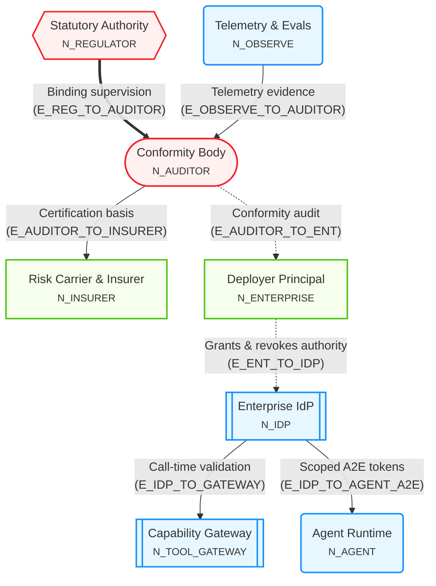

# Continuing Assurance: Can We Still Trust Yesterday's Approval Today?

## The Question

> **"AI models, agent runtimes, and execution tools update constantly. How does the ecosystem ensure that approvals, insurance, and safety checks remain valid over time—and how does the architecture pull permissions when something goes wrong?"**

---

## The Interactive View

Select the **Continuing Assurance** (`V_ASSURANCE`) view in the interactive graphic below. With that view selected, the non-participating nodes in the wider ecosystem are dimmed into the background, highlighting the supervisory lines, independent evidence pathways, and the delegated authority kill-chain:

  <iframe
    src="/viewer/?view=V_ASSURANCE&inquiry=assurance" 
    width="100%" 
    height="100%" 
    style={{ border: '1px solid #282d3c', borderRadius: '8px', backgroundColor: '#14161d' }} 
    title="Continuing Assurance Interactive View"
  ></iframe>

*(Tip: Click on `N_AUDITOR`, `N_REGULATOR`, or `N_IDP` in the viewer above to inspect their VSM frame roles, Ashby variety, and connected edges).*

---

## The Sense-Making Context: The Point-in-Time Fallacy

Traditional enterprise compliance operates on a **static certification model**: an accredited conformity body audits an application at deployment time (*T0*), issues an ISO/IEC 42001 or EU AI Act certificate, and walks away until the annual renewal.

In the AI ecosystem, this model fails. Autonomous systems drift across three dimensions:
1. **Model Drift & Evals:** Foundation model inference endpoints (`N_FRONTIER_MODEL`) receive upstream weight updates, prompt mitigations, and latency-optimized distillation.
2. **Context & Tool Poisoning:** Agent reasoning loops dynamically consume external tools (`N_TOOL_GATEWAY`) and vector retrieval data, expanding their operational blast radius.
3. **Adversarial Exploitation:** New prompt injection vectors (`N_THREAT_ACTOR`) emerge post-deployment.

If assurance is static, an organization can operate an agent that possesses valid compliance paperwork while actively inflicting real-world harm. For an ecosystem to be cybernetically viable, assurance must be **continuous**, **independently testable**, and backed by **real-time authority revocation**.

---

## Architectural Mechanisms in the Model

The model formalizes continuing assurance across four distinct cybernetic loops:

### 1. Supervisory Reassessment & Suspension
Conformity assessment bodies cannot operate in an unconstrained market. 
Under edge `E_REG_TO_AUDITOR`, statutory authorities (`N_REGULATOR`) maintain binding oversight over notified and certification bodies (`N_AUDITOR`). When systemic failures or threshold-breaching incidents occur, the regulator has the statutory power to suspend accreditation or mandate immediate post-market reassessment.

### 2. Independent Evidence Pathways (Avoiding the Self-Reporting Trap)
Can an enterprise hide adverse behavior from its auditor?
The model evaluates whether adverse signals can reach the conformity body **independently of the enterprise’s internal management line**:
* **Direct Telemetry:** Enterprise evaluation platforms (`N_OBSERVE`) feed runtime behavioral logs via `E_OBSERVE_TO_AUDITOR`. However, because `N_OBSERVE` is enterprise-operated, this evidence is considered internal.
* **External Whistleblower & Complaint Route:** When harm impacts consumers (`N_AFFECTED_PARTY`), complaints flow via `E_AFFECTED_TO_REG_COMPLAINT` to `N_REGULATOR`, which directly compels `N_AUDITOR` via `E_REG_TO_AUDITOR`.
* **Civil Society & Investigative Alarm:** If regulatory capture delays formal complaints, investigative journalists and researchers (`N_CIVIL_SOCIETY`) trigger an emergency algedonic alarm `E_CIVIL_TO_LEG_ALARM` to the legislature (`N_LEGISLATURE`), which widens the statutory powers of `N_REGULATOR` via `E_LEG_TO_REG_MANDATE`.

### 3. Third-Party Economic Reliance
Certifications are meaningless if no market participant relies on them to constrain behavior. 
Under edge `E_AUDITOR_TO_INSURER`, risk underwriters and insurers (`N_INSURER`) use the conformity determination from `N_AUDITOR` as an objective gate for algorithmic liability policies. If an auditor suspends certification, insurance coverage lapses, activating the underwriting gate `E_INSURER_TO_ENT_GATE` and economically halting uninsured deployment.

### 4. The Delegated Authority Kill-Chain (Solving the "Confused Deputy")
If an auditor or enterprise principal revokes an agent's authority, how does the technical stack enforce that decision?
In flawed architectures, an enterprise disables an agent in its prompt harness, but the agent still holds long-lived OAuth tokens or API keys, allowing it to continue making unauthenticated calls.

The model proves that the delegation chain is structurally closed:
1. **Authority Delegation:** The enterprise principal delegates authority to its Identity Provider (`N_IDP`) via `E_ENT_TO_IDP`.
2. **Credential Scoping:** `N_IDP` issues short-lived, scoped A2E workload credentials to the agent (`N_AGENT`) via `E_IDP_TO_AGENT_A2E`.
3. **Call-Time Gateway Verification:** Crucially, under `E_IDP_TO_GATEWAY`, the Capability & Tool Gateway (`N_TOOL_GATEWAY`) validates the credential with `N_IDP` at invocation time. 

If authority is revoked at the IdP, the tool gateway immediately blocks execution on target operational systems (`N_TARGET_SYS`), even if the agent is actively attempting to run an autonomous loop.

### Strategic Takeaways for Leaders & Architects

1. **Never Rely on Static Paperwork:** Point-in-time compliance certificates provide zero assurance against autonomous drift. Continuous evaluation telemetry (N_OBSERVE) and sovereign tamper-evident record keeping (N_AUDIT_STORE) must be continuously mapped to the conformity baseline.

2. **Independent Alarms Must Bypass Deployers:** An assurance system where all incident reporting flows through enterprise PR or legal channels is cybernetically unstable. External algedonic channels (regulators, research bodies, civil society) are essential counterweights.

3. **Decouple Tool Brokering from Agent Reasoning:** Autonomous agents should never hold direct, long-lived credentials to databases or transactional APIs. All tool calls must be brokered through a hardened capability gateway (N_TOOL_GATEWAY) that performs call-time validation against the enterprise Identity Provider (N_IDP).