# Where are the Critical Physical and Geopolitical Supply-Chain Chokepoints in the AI Ecosystem?

## 1. Executive Summary & Core Thesis
Conventional AI discourse treats AI as a cloud-based software abstraction governed by algorithmic breakthroughs and software APIs. 

The canonical model exposes this framing as an illusion. The entire global AI ecosystem is governed by an extreme **cardinality inversion (Ashby's Variety in Reverse)**: while downstream software agent invocations number in the billions (10<sup>9</sup>) across hundreds of thousands of commercial deployers (10<sup>5</sup>), the entire physical foundation converges into an apex of **monopolistic manufacturing chokepoints (10<sup>0</sup>)** and **rigid physical electrical grids (10<sup>2</sup>)**.

True sovereignty and strategic vulnerability do not reside in the software weights or local data residency laws; they are determined by:
1. **Extreme Lithography Concentration:** Complete physical dependence on ASML (extreme ultraviolet optics) and TSMC (3nm/2nm foundries and CoWoS advanced packaging).
2. **The Ampere's Law Bottleneck:** Electrical substation transformer lead times (3–5 years) and gigawatt grid interconnect queues that act as a hard physical speed limit on data-center scaling.
3. **The Fiction of Data Residency:** Storing customer data within national borders provides zero jurisdictional independence if the underlying inference silicon is subject to foreign extraterritorial export controls.

---

## 2. Model Perspective

The diagram below isolates the upstream physical foundation from the downstream application runtime, showing how capital and statutory mandates interact at the physical bottleneck:

```mermaid
flowchart TB
    classDef physical fill:#FFFBE6,stroke:#D48806,stroke-width:2px;
    classDef econ fill:#F6FFED,stroke:#52C41A,stroke-width:2px;
    classDef gov fill:#FFF1F0,stroke:#F5222D,stroke-width:2px;
    classDef tech fill:#E6F7FF,stroke:#1890FF,stroke-width:2px;
    classDef dim fill:#F8FAFC,stroke:#E2E8F0,color:#94A3B8,stroke-dasharray: 3 3;

    %% Dimmed Downstream Context
    N_ISV_PRODUCT[AI Applications]:::dim
    N_AGENT[Agent Runtime]:::dim
    N_GUARDRAIL[Policy Guardrail Kernel]:::dim
    N_TOOL_GATEWAY[Capability Gateway]:::dim
    N_TARGET_SYS[Target Systems & APIs]:::dim
    N_AFFECTED_PARTY[Affected Individuals]:::dim

    %% Geopolitical Authority & Macro Capital
    subgraph cluster_regulatory ["0. Jurisdictional, Capital & Regulatory Sphere"]
        N_REGULATOR{{"Statutory &amp; Trade Authorities<br/><small><i>BIS Export Controls, CFIUS, Sovereignty Mandates</i></small>"}}:::gov
        N_CAPITAL["Capital Markets &amp; Sovereign Funds<br/><small><i>$600B Infrastructure Financing</i></small>"]:::econ
    end

    %% Physical Hardware & Resource Layer
    subgraph Cluster_Physical ["The Physical Chokepoint Layer"]
        N_SILICON["Leading-Edge Silicon &amp; Lithography<br/><small><i>ASML (EUV), TSMC (3nm/2nm), CoWoS Packaging</i></small>"]:::physical
        N_ENERGY_GRID[("Energy Grids &amp; Power Generation<br/><small><i>Nuclear PPAs, Substation Transformers, Water</i></small>")]:::physical
    end

    %% Upstream Compute & Foundation Lab
    subgraph cluster_supply ["1. Upstream Silicon, Cloud &amp; Model Supply"]
        N_TRAIN["Training Compute Campuses<br/><small><i>GW-Scale Cluster Fabric</i></small>"]:::econ
        N_FRONTIER_LAB["Frontier AI Labs<br/><small><i>Model Developers</i></small>"]:::econ
        N_FRONTIER_MODEL("Frontier Foundation Model<br/><small><i>Globally Replicated Weights Fleet</i></small>"):::tech
    end

    %% Enterprise Deployer
    subgraph cluster_client ["3. Enterprise Deployer Domain"]
        N_ENTERPRISE["Enterprise Deployer<br/><small><i>Legal Principal &amp; Economic Sponsor</i></small>"]:::econ
    end

    %% Capital Allocation Flows
    N_CAPITAL == "$$$ Fab capex & lithography tool procurement" ==> N_SILICON
    N_CAPITAL == "$$$ Clean-energy PPAs & grid upgrades" ==> N_ENERGY_GRID
    N_CAPITAL == "$$$ Campus project debt & equity" ==> N_TRAIN

    %% Statutory & National Security Mandates
    N_REGULATOR == "Export controls, entity listings & technology sanctions" ==> N_SILICON

    %% Physical Resource Constraints & Allocation
    N_SILICON -->|"Leading-edge GPU allocation & advanced packaging"| N_TRAIN
    N_ENERGY_GRID -. "Physical GW power & transformer bottleneck" .-> N_TRAIN

    %% Compute into Foundation Weights
    N_FRONTIER_LAB -->|"Trains, gates and releases the model"| N_FRONTIER_MODEL
    N_ENTERPRISE -. "Sovereignty Gap: Local Data on Foreign Silicon" .-> N_FRONTIER_MODEL
```



## 3. Systemic Mechanics & Walkthrough

### 1. The Inverted Pyramid of Variety (Ashby in Reverse)

In Stafford Beer’s cybernetics, **Ashby's Law of Requisite Variety** states that control requires variety to absorb disturbances. When looking at the physical supply chain, we see the inverse: extreme vulnerability via **hyper-concentration**:

```text
[Downstream Invocations & Agents]      10^8 - 10^9 invocations/year
       ▲
[Commercial Deployers]                 10^5 enterprises globally
       ▲
[Vertical SaaS Applications]           10^4 specialized ISVs
       ▲
[Frontier Model Labs]                  Top 5-10 research labs
       ▲
[Energy Grids & Utility Nodes]         10^2 regional interconnection queues
       ▲
[Semiconductor Monopolies]             10^0 - 10^1 (ASML, TSMC, Nvidia)
```

The entire global AI capital cycle rests on a needlepoint of single-digit physical entities.

### 2. The Silicon Chokepoint — N_SILICON

- **Single Point of Failure (Lithography):** All leading-edge training and inference silicon (\<5nm) relies on Extreme Ultraviolet (EUV) photolithography machines produced by a single company in Veldhoven, Netherlands (**ASML**).

- **Single Point of Failure (Foundry & Packaging):** Over 90% of advanced AI accelerators are fabricated and packaged using proprietary chip-on-wafer-on-substrate (CoWoS) technology by **TSMC in Hsinchu and Tainan, Taiwan**.

- **Geopolitical Weaponization (N_REGULATOR):** National trade authorities enforce extraterritorial Export Administration Regulations (EAR) on this node, using compute density and bandwidth thresholds to legally blockade adversary nations from acquiring leading-edge clusters.

### 3. The Energy Grid Ceiling — N_ENERGY_GRID

- **The Speed Limit on Scaling:** While software deployment takes seconds, electrical infrastructure operates on multi-year industrial cycles:
  
  - High-voltage substation transformers: **3–5 year manufacturing backlog**.
  
  - Utility interconnection queue approvals: **4–7 years in major regional grids**.

- **The Nuclear & Clean Power Shift:** Because training runs of 1026–1027 FLOPs require 100MW–1GW of continuous, non-intermittent baseline power, hyperscalers are executing long-term private Power Purchase Agreements (PPAs) with dedicated nuclear plants and small modular reactor (SMR) developers.

- **Physical Constraint Polarity:** The relationship E_ENERGY_TO_TRAIN carries a **physical_constraint** type with **negative (-) polarity**: as compute cluster demand accelerates, local grid capacity acts as a dampening feedback loop that halts physical construction regardless of available financial capital (N_CAPITAL).

---

## 4. Cybernetic & Geopolitical Tensions

| Node Pair                                                   | Structural Tension                     | Strategic / Economic Consequence                                                                                                                        |
| ----------------------------------------------------------- | -------------------------------------- | ------------------------------------------------------------------------------------------------------------------------------------------------------- |
| N_REGULATOR → N_SILICON         | **Extraterritorial Sanctions**         | Export bans prevent foundries from servicing certain global markets, bifurcating the global hardware stack.                                             |
| N_ENERGY_GRID → N_TRAIN         | **Physical Infrastructure Bottleneck** | Capital investment cannot convert into operational capacity until physical substations and cooling permits are cleared.                                 |
| N_CAPITAL → N_SILICON           | **Capital Intensity Overhang**         | Constructing a single leading-edge fab costs upwards of $20B; failure of frontier labs to generate commercial software ROI creates systemic debt risks. |
| N_ENTERPRISE → N_FRONTIER_MODEL | **Sovereignty Decoupling**             | Deployers are caught between strict domestic regulatory compliance and total physical dependence on a concentrated foreign hardware oligopoly.          |

---

## 5. Model Feedback & Audit Trail

- **Entities Evaluated:** N_SILICON, N_ENERGY_GRID, N_CAPITAL, N_REGULATOR, N_TRAIN, N_FRONTIER_LAB, N_FRONTIER_MODEL, N_ENTERPRISE, N_AFFECTED_PARTY.

- **Ontological Additions Resolved (v3.2):**
   
  - Classified the energy bottleneck as a physical_constraint rather than a liability_exposure.