# Where is the "AI Agent" in this Architecture? Enterprise vs. User Agents

## 1. Executive Summary & Core Thesis
When viewers search the canonical model for a single box labeled **"AI Agent"**, they will not find one. This is by design. 

In this architecture, treating an AI Agent as an atomic, standalone box is an **ontological category mistake**. An AI Agent is an **emergent cybernetic loop** formed when distinct architectural roles converge: **Reasoning Core**, **Execution Loop**, **Governor**, **Semantic Memory**, **Tool Actuation**, and **Legal Principal**.

Crucially, the ecosystem contains two fundamentally different agent assemblies that are routinely conflated in public discourse:
1. **The Enterprise Agent (Delegated Institutional Agency):** A corporate legal entity (`N_ENTERPRISE`) delegates scoped authority through an Enterprise IdP (`N_IDP`), bounds execution via an independent policy guardrail kernel (`N_GUARDRAIL`, VSM System 3), records state in an immutable audit ledger (`N_AUDIT_STORE`), and acts upon production ERPs and financial rails (`N_TARGET_SYS`).
2. **The User Agent (Personal / Consumer Agency):** An individual natural person (`N_HUMAN_USER` or `N_AFFECTED_PARTY`) delegates personal intent directly through a consumer client or operating system (`N_ISV_PRODUCT`), accesses local device context (emails, files, photos), and executes client-side actions. User agents frequently lack a formal VSM System 3 policy kernel, leaving the individual exposed to prompt-injection attacks (`N_THREAT_ACTOR`) and sole personal liability under click-wrap Terms of Service.

---

## 2. Model Perspective

The diagram below highlights both the **Enterprise Agent loop** and the **User Agent loop**, showing where they share cognitive inference infrastructure and where their governance boundaries diverge:

```mermaid
flowchart TB
    classDef gov fill:#FFF1F0,stroke:#F5222D,stroke-width:2px;
    classDef econ fill:#F6FFED,stroke:#52C41A,stroke-width:2px;
    classDef tech fill:#E6F7FF,stroke:#1890FF,stroke-width:2px;
    classDef dim fill:#F8FAFC,stroke:#E2E8F0,color:#94A3B8,stroke-dasharray: 3 3;

    %% Dimmed Context
    N_REGULATOR[Statutory Authorities]:::dim
    N_AUDITOR[Conformity Bodies]:::dim
    N_INSURER[AI Risk Underwriter]:::dim
    N_CAPITAL[Capital Markets]:::dim
    N_SILICON[Silicon & Fabs]:::dim
    N_ENERGY_GRID[Energy Grids]:::dim
    N_TRAIN[Compute Campuses]:::dim
    N_CLOUD_HYPERSCALER[Cloud Platforms]:::dim
    N_FRONTIER_LAB[Frontier AI Labs]:::dim

    %% Cluster 3: Enterprise Principal Domain
    subgraph cluster_client ["3. Enterprise Deployer Domain (Enterprise Principal)"]
        N_ENTERPRISE["Enterprise Deployer<br/><small><i>Institutional Legal Principal (S5)</i></small>"]:::econ
        N_IDP(["Enterprise IdP<br/><small><i>OAuth &amp; Ephemeral IAM</i></small>"]):::tech
        N_KNOWLEDGE_STORE[("Enterprise Knowledge Base<br/><small><i>Vector DB &amp; Corporate RAG</i></small>")]:::tech
    end

    %% Cluster 2: Execution Infrastructure & Governance Kernel
    subgraph cluster_product ["2. Application & Agent Runtime Domain"]
        N_ISV_PRODUCT("AI Applications & Client Runtimes<br/><small><i>Vertical SaaS &amp; Consumer Apps</i></small>"):::econ
        N_AGENT("Agent Runtime<br/><small><i>Plan-Act Execution Loop (S1)</i></small>"):::tech
        N_GUARDRAIL[["Policy &amp; Guardrail Kernel<br/><small><i>The Governor: Scope &amp; Budget Gate (S3)</i></small>"]]:::tech
        N_AUDIT_STORE[("Sovereign Audit Ledger<br/><small><i>Art. 12 WORM Logging</i></small>")]:::tech
        N_OBSERVE("Observability &amp; Evals Engine<br/><small><i>S3* Independent Probes</i></small>"):::tech
    end

    %% Cluster 1: Cognitive Intelligence Supply
    subgraph cluster_supply ["1. Upstream Foundation Model Layer"]
        N_FRONTIER_MODEL("Frontier Foundation Model<br/><small><i>Proprietary API Fleet Weights</i></small>"):::tech
        N_OPEN_MODEL("Open-Weight Model Commons<br/><small><i>Local / On-Device SLM Weights</i></small>"):::tech
    end

    %% Cluster 4: Real-World Actuation, Personal Principals & Adversaries
    subgraph cluster_environment ["4. Execution Environment, Personal Agents & Society"]
        N_HUMAN_USER(("Human Task Delegator<br/><small><i>Natural Person / Enterprise Operator</i></small>")):::gov
        N_AFFECTED_PARTY(("Consumer / End User<br/><small><i>Personal Agent Principal (DTC)</i></small>")):::gov
        N_TOOL_GATEWAY[["Capability &amp; Tool Gateway<br/><small><i>Decoupled Broker (MCP)</i></small>"]]:::tech
        N_TARGET_SYS[("Target Systems &amp; APIs<br/><small><i>Production Databases &amp; Rails</i></small>")]:::tech
        N_THREAT_ACTOR{{"Threat Actors<br/><small><i>Prompt Injection &amp; Tool Poisoning</i></small>"}}:::gov
    end

    %% Loop 1: The Enterprise Agent Flow
    N_ENTERPRISE == "Delegates Corporate Authority (S5 to S3)" ==> N_GUARDRAIL
    N_IDP -->|"A2E Workload IAM Delegation"| N_AGENT
    N_GUARDRAIL -. "Enforces Policy Envelope (S3 to S1)" .-> N_AGENT
    N_AGENT -->|"Action Proposals for Authorisation"| N_GUARDRAIL
    N_GUARDRAIL -->|"Tamper-Evident Decision Trail"| N_AUDIT_STORE
    N_AGENT -->|"MIP Inference API"| N_FRONTIER_MODEL
    N_AGENT -->|"RAG Corporate Context"| N_KNOWLEDGE_STORE
    N_GUARDRAIL -. "Enforces Least-Privilege Scopes" .-> N_TOOL_GATEWAY
    N_AGENT -->|"A2T Tool Calling (MCP)"| N_TOOL_GATEWAY
    N_TOOL_GATEWAY -->|"Authenticated Operations Execution"| N_TARGET_SYS
    N_OBSERVE -. "S3* Independent Behavioural Probe" .-> N_TARGET_SYS
    N_TARGET_SYS == "🚨 Algedonic Circuit Breaker" ==> N_ENTERPRISE
    N_ENTERPRISE -. "Vicarious Liability for Harm" .-> N_AFFECTED_PARTY

    %% Loop 2: The User Agent Flow (Personal / Consumer Agency)
    N_HUMAN_USER -->|"Direct Personal Prompt Intent"| N_ISV_PRODUCT
    N_AFFECTED_PARTY -->|"Consumer Demand & Direct Usage"| N_ISV_PRODUCT
    N_ISV_PRODUCT -->|"Direct-to-Consumer AI Interaction"| N_AFFECTED_PARTY
    N_ISV_PRODUCT -->|"Instantiates Personal Agent Loop"| N_AGENT
    N_AGENT -->|"Local Inference / Private Weights"| N_OPEN_MODEL
    N_HUMAN_USER == "Art. 14 Human Oversight & Kill Switch" ==> N_AGENT
    N_THREAT_ACTOR -. "⚡ Prompt Injection & Jailbreak Attacks" .-> N_AGENT
```

---

## 3. Systemic Mechanics & Walkthrough

### 3.1 Anatomy of an Enterprise Agent (Institutional Agency)

An Enterprise Agent operates under the legal framework of **commercial agency and corporate vicarious liability (respondeat superior)**:

1. **The Legal Principal (N_ENTERPRISE):** A registered corporation sponsors the agent, assumes balance-sheet risk, and establishes normative policy boundaries (**VSM System 5**).

2. **Workload Identity (N_IDP):** The agent does not log in with personal user credentials. The enterprise directory provisions machine-to-machine workload identities using scoped, short-lived OAuth/OIDC tokens over the **Agent-to-Enterprise (A2E)** protocol plane.

3. **The Governor (N_GUARDRAIL):** The execution loop is strictly bounded by an independent policy kernel (**VSM System 3**). The kernel enforces data-loss prevention (DLP), budget caps, and permissible tool scopes. It acts as a deterministic firewall between the probabilistic model and production APIs.

4. **The Flight Recorder (N_AUDIT_STORE):** To comply with Article 12 of the EU AI Act and satisfy risk underwriters (N_INSURER), every proposal, authorization, and tool execution is piped to a tamper-evident WORM ledger.

5. **Decoupled Actuation (N_TOOL_GATEWAY** → N_TARGET_SYS):** The agent never holds direct database credentials. It negotiates tool calls via the Model Context Protocol (**A2T plane**), executing authenticated reads and writes against corporate ERPs and financial rails.

### 3.2 Anatomy of a User Agent (Personal / Consumer Agency)

A User Agent operates under the legal framework of **direct personal action and consumer contract law**:

1. **The Personal Principal (N_HUMAN_USER / N_AFFECTED_PARTY):** An individual consumer or employee acts as the ultimate principal. The agent acts in their personal name.

2. **Client-Side Authentication:** Instead of enterprise IAM, the agent relies on personal device credentials: local OS keychains, passkeys, biometric locks, or active browser session cookies.

3. **Personal Context:** Memory is not an enterprise vector database; it is the user's personal digital exhaust: local files, personal email history, photos, calendar, and browser cache.

4. **The Missing Governor (The S3 Vacuum):** In most personal agent implementations (e.g., local open-source agents or browser automation extensions), **there is no independent policy kernel (N_GUARDRAIL)**. The individual user is expected to act as the planner, governor, and supervisor simultaneously.

5. **Direct Client Actuation:** The agent actuates through the local operating system or browser, clicking web elements, drafting personal emails, or executing local terminal scripts.

6. **On-Device Cognition (N_OPEN_MODEL):** While user agents can call cloud APIs, privacy-sensitive personal agents increasingly run on-device Small Language Models (SLMs) derived from open-weight commons, avoiding the wholesale token toll.

---

## 4. Cybernetic & Governance Tensions

### Functional Role Comparison

| Functional Role          | Enterprise Agent (Corporate Loop)                                                    | User Agent (Personal Loop)                                            |
| ------------------------ | ------------------------------------------------------------------------------------ | --------------------------------------------------------------------- |
| **Legal Principal**      | N_ENTERPRISE (Corporation / Legal Entity)                                            | N_HUMAN_USER / N_AFFECTED_PARTY (Natural Person)                      |
| **Identity Delegation**  | N_IDP (Workload IAM, ephemeral machine tokens)                                       | Personal Client Identity (Passkeys, browser cookies, OS keychain)     |
| **Semantic Memory**      | N_KNOWLEDGE_STORE (Vector DBs, proprietary corporate RAG)                            | Personal Context (Local files, personal email, device storage)        |
| **Governor (Guardrail)** | N_GUARDRAIL (Corporate DLP, budget caps, ISO 42001 kernel)                           | Client / OS Sandbox (Thin OS permissions, basic prompt filters)       |
| **Tool Actuation**       | N_TOOL_GATEWAY → N_TARGET_SYS (B2B MCP broker into ERPs) | Direct Client Actuation (Local OS, browser automation, consumer APIs) |
| **Cognitive Brain**      | N_FRONTIER_MODEL (Wholesale enterprise API tenancy)                                  | N_OPEN_MODEL (Local SLM) or N_ISV_PRODUCT (Consumer SaaS)             |
| **Audit Ledger**         | N_AUDIT_STORE (Sovereign WORM ledger for regulatory defense)                         | Ephemeral Local Logs (Unverified, client-side history)                |
| **Liability Allocation** | N_ENTERPRISE holds strict vicarious liability                                        | **Individual Consumer holds direct personal liability**               |

---

### The Two Critical User Agent Vulnerabilities

#### 1. The Click-Wrap Liability Trap

When an individual deploys a personal AI agent to book travel, trade stocks, or manage correspondence, foundation model labs disclaim all warranties via consumer ToS (contractual_term).

Because there is no corporate principal to absorb the risk, **the natural person bears 100% of the civil and contractual liability** for any unauthorized commitment or erroneous transaction executed by their agent.

#### 2. The Adversarial Injection Vector (N_THREAT_ACTOR)

Because User Agents lack the hardened, decoupled VSM System 3 policy kernel (N_GUARDRAIL) present in enterprise architectures:

- An adversary (N_THREAT_ACTOR) can embed indirect prompt-injection instructions inside an inbound email or web page.

- When the personal agent reads the context, it is hijacked, executing malicious tool calls (such as exfiltrating personal cookies or sending unauthorized emails) using the user's personal client permissions.

---

## 5. Model Feedback & Audit Trail

- **Entities Evaluated:** N_ENTERPRISE, N_HUMAN_USER, N_IDP, N_AGENT, N_GUARDRAIL, N_FRONTIER_MODEL, N_OPEN_MODEL, N_ISV_PRODUCT, N_KNOWLEDGE_STORE, N_TOOL_GATEWAY, N_TARGET_SYS, N_AUDIT_STORE, N_OBSERVE, N_AFFECTED_PARTY, N_THREAT_ACTOR.

- **Ontological Alignment Verified (v3.0):**
  
  - Contrasted institutional delegated agency (F_ENTERPRISE frame) with direct consumer agency (E_AFFECTED_TO_ISV_DEMAND and E_ISV_TO_AFFECTED_DTC).
  
  - Demonstrated that an AI agent is an emergent socio-technical loop whose legal liability and security posture depend entirely on whether the principal is an **institutional enterprise** or an **individual consumer**.

