# Where is the "AI Agent" in this Architecture?

## 1. Executive Summary & Core Thesis
When viewers search the canonical model for a single box labeled **"AI Agent"**, they will not find one. This is by design. 

In this architecture, treating an AI Agent as a monolithic, atomic box is an **ontological category mistake**. An AI Agent is an **emergent cybernetic loop** formed when distinct architectural roles converge: **Reasoning Core** (`N_FRONTIER_MODEL`), **Execution Loop** (`N_AGENT`), **Deterministic Governor** (`N_GUARDRAIL`), **Semantic Memory** (`N_KNOWLEDGE_STORE`), **Tool Actuation** (`N_TOOL_GATEWAY`), and **Legal Principal** (`N_ENTERPRISE`).

The v3.0 model explicitly separates the **Agent Worker** (`N_AGENT`, VSM System 1) from the **Policy Guardrail** (`N_GUARDRAIL`, VSM System 3). Collapsing these roles into a single "agent" entity obscures where software failure modes occur, where deterministic safety gates operate, and where statutory vicarious liability (*respondeat superior*) actually settles.

---

## 2. Model Perspective

The diagram below highlights the socio-technical loop that forms an active enterprise agent:

```mermaid
flowchart TB
    classDef gov fill:#FFF1F0,stroke:#F5222D,stroke-width:2px;
    classDef econ fill:#F6FFED,stroke:#52C41A,stroke-width:2px;
    classDef tech fill:#E6F7FF,stroke:#1890FF,stroke-width:2px;
    classDef dim fill:#F8FAFC,stroke:#E2E8F0,color:#94A3B8,stroke-dasharray: 3 3;

    %% Dimmed Context
    N_REGULATOR[Statutory Authorities]:::dim
    N_AUDITOR[Conformity Bodies]:::dim
    N_INSURER[AI Risk Underwriter]:::dim
    N_CAPITAL[Capital Markets]:::dim
    N_SILICON[Silicon & Fabs]:::dim
    N_ENERGY_GRID[Energy Grids]:::dim
    N_TRAIN[Compute Campuses]:::dim
    N_CLOUD_HYPERSCALER[Cloud Hyperscalers]:::dim
    N_FRONTIER_LAB[Frontier AI Labs]:::dim
    N_ISV_PRODUCT[AI Applications]:::dim

    %% Cluster 3: The Principal Domain
    subgraph cluster_client ["3. Enterprise Deployer Domain"]
        N_ENTERPRISE["Enterprise Deployer<br/><small><i>Legal Principal &amp; S5 Policy</i></small>"]:::econ
        N_HUMAN_USER(("Human Task Delegator<br/><small><i>Art. 14 HITL Supervisor</i></small>")):::gov
        N_IDP(["Enterprise IdP<br/><small><i>OAuth &amp; Ephemeral IAM</i></small>"]):::tech
        N_KNOWLEDGE_STORE[("Enterprise Semantic Knowledge Base<br/><small><i>Vector DB &amp; CoALA Memory</i></small>")]:::tech
    end

    %% Cluster 2: Runtime & Governance Kernel
    subgraph cluster_product ["2. Application & Agent Domain"]
        N_AGENT("Agent Runtime<br/><small><i>The Worker: Plan-Act Loop (S1)</i></small>"):::tech
        N_GUARDRAIL[["Policy &amp; Guardrail Kernel<br/><small><i>The Governor: Scope &amp; Budget Gate (S3)</i></small>"]]:::tech
        N_AUDIT_STORE[("Sovereign Audit Ledger<br/><small><i>Art. 12 WORM Logging</i></small>")]:::tech
        N_OBSERVE("Observability &amp; Evals Engine<br/><small><i>S3* Independent Probes</i></small>"):::tech
    end

    %% Cluster 1: Probabilistic Model Artifact
    subgraph cluster_supply ["1. Upstream Model Artifact"]
        N_FRONTIER_MODEL("Frontier Foundation Model<br/><small><i>Inference Weights Core</i></small>"):::tech
    end

    %% Cluster 4: Real-World Actuation
    subgraph cluster_environment ["4. Target Execution Environment & Blast Radius"]
        N_TOOL_GATEWAY[["Capability &amp; Tool Gateway<br/><small><i>Decoupled Broker (MCP)</i></small>"]]:::tech
        N_TARGET_SYS[("Target Systems &amp; APIs<br/><small><i>Operational State of Record</i></small>")]:::tech
        N_AFFECTED_PARTY(("Affected Individuals<br/><small><i>Consumers, Citizens</i></small>")):::gov
    end

    %% Authority & Delegation
    N_ENTERPRISE == "Delegates Authority & Safety Boundaries (S5 to S3)" ==> N_GUARDRAIL
    N_HUMAN_USER == "Art. 14 Human Oversight & Kill Switch" ==> N_AGENT
    N_IDP -->|"A2E Workload Identity Delegation"| N_AGENT

    %% The Cybernetic Control Seam between S3 and S1
    N_GUARDRAIL -. "Policy Envelope & Runtime Constraints (S3 to S1)" .-> N_AGENT
    N_AGENT -->|"Action Proposals for Pre-Execution Authorisation"| N_GUARDRAIL
    N_GUARDRAIL -->|"Tamper-Evident Decision Trail (Art. 12)"| N_AUDIT_STORE

    %% Operational Actuation
    N_AGENT -->|"MIP Inference API (Tokens)"| N_FRONTIER_MODEL
    N_AGENT -->|"RAG Semantic Retrieval"| N_KNOWLEDGE_STORE
    N_GUARDRAIL -. "Enforces Least-Privilege Scopes (S3 to S2)" .-> N_TOOL_GATEWAY
    N_AGENT -->|"A2T Tool Calling (MCP)"| N_TOOL_GATEWAY
    N_TOOL_GATEWAY -->|"Authenticated Operations Execution"| N_TARGET_SYS

    %% Independent S3* Probe & Algedonic Emergency Tripwire
    N_OBSERVE -. "S3* Independent Behavioural Probe" .-> N_TARGET_SYS
    N_TARGET_SYS == "🚨 Algedonic Alarm (Direct S1 to S5 Circuit Breaker)" ==> N_ENTERPRISE

    %% Tensions & Liability
    N_TARGET_SYS -. "Direct Impact & Real-World Blast Radius" .-> N_AFFECTED_PARTY
    N_ENTERPRISE -. "Vicarious Liability for Harm (Respondeat Superior)" .-> N_AFFECTED_PARTY
```

## 3. Systemic Mechanics & Walkthrough

The composite agent loop decomposes into six distinct functional roles:

### 1. The Brain (Probabilistic Reasoning Core) — N_FRONTIER_MODEL

- **Role:** Stateless next-token prediction, planning proposals, and linguistic abstraction.

- **Why it is not an agent:** It possesses no agency, no persistent memory, no internal clock, and no ability to actuate changes in the world. It is a technical software artifact licensed under standard commercial ToS.

### 2. The Worker (Operational Execution Loop) — N_AGENT

- **Role:** The orchestration while-loop (e.g., LangGraph, AutoGen, or custom runtimes).

- **VSM Role:** **System 1 (Primary Operational Unit)** in the enterprise frame (F_ENTERPRISE).

- **Function:** Maintains execution state, manages working and episodic memory, queries model inference via the MIP protocol, and proposes tool actions.

### 3. The Governor (Deterministic Policy Kernel) — N_GUARDRAIL

- **Role:** The boundary controller and budget gatekeeper.

- **VSM Role:** **System 3 (Operational Control)** in the enterprise frame (F_ENTERPRISE).

- **Function:** Intercepts proposed actions before execution, validates token consumption thresholds, verifies authorization scopes against corporate policy, and writes an unalterable log to N_AUDIT_STORE.

### 4. The Memory (Semantic Context) — N_KNOWLEDGE_STORE

- **Role:** Grounding the agent in organizational reality.

- **Framework:** Implements the **CoALA (Cognitive Architectures for Language Agents)** memory model (Semantic and Episodic stores).

### 5. The Hands (Decoupled Actuation) — N_TOOL_GATEWAY → N_TARGET_SYS

- **Role:** Execution of real-world state changes (database writes, transaction execution, ERP updates).

- **Protocol Plane:** Communicates via the **Agent-to-Tool (A2T)** protocol (Model Context Protocol / OpenAPI).

- **VSM Tier:** **System 2 (Coordination & Damping)**.

### 6. The Principal (Conferral of Legal Agency) — N_ENTERPRISE, N_HUMAN_USER, N_IDP

- **Role:** A software loop cannot be an agent in law without a **legal principal**.

- **Governance Mandate:** The N_ENTERPRISE sponsors the agent, defines its policy envelope, and provisions machine identity through the Enterprise Identity Provider (N_IDP) using scoped ephemeral tokens (A2E protocol).

- **Human-in-the-Loop:** N_HUMAN_USER provides initial intent and retains continuous supervisory capability, including the mandatory kill switch mandated by Article 14 of the EU AI Act.

---

## 4. Cybernetic & Governance Tensions

| Boundary                                                    | Interaction                | Cybernetic / Governance Risk                                                                                                              |
| ----------------------------------------------------------- | -------------------------- | ----------------------------------------------------------------------------------------------------------------------------------------- |
| N_GUARDRAIL → N_AGENT           | **S3 Control Envelope**    | Guardrails must constrain probabilistic hallucinations without choking autonomous operational problem-solving.                            |
| N_AGENT → N_FRONTIER_MODEL      | **Probabilistic Gap**      | The agent relies on a non-deterministic inference engine that disclaims liability for incorrect or biased outputs.                        |
| N_OBSERVE → N_TARGET_SYS        | **S3* Independence**       | Without independent behavioral sampling, the enterprise is blind to what the agent runtime fails or chooses not to log.                   |
| N_TARGET_SYS → N_ENTERPRISE     | **Algedonic Latency**      | If emergency circuit breakers fail, runaway agent loops cause catastrophic real-world balance sheet damage.                               |
| N_TARGET_SYS → N_AFFECTED_PARTY | **Blast Radius Causation** | Actions taken by the agent impact external citizens; the legal doctrine of respondeat superior imputes direct fault back to N_ENTERPRISE. |

---

## 5. Model Feedback & Audit Trail

- **Entities Evaluated:** N_ENTERPRISE, N_HUMAN_USER, N_IDP, N_AGENT, N_GUARDRAIL, N_FRONTIER_MODEL, N_KNOWLEDGE_STORE, N_TOOL_GATEWAY, N_TARGET_SYS, N_AUDIT_STORE, N_OBSERVE, N_AFFECTED_PARTY.

- **Ontological Refinements Verified (v3.0):**
  
  - Explicitly separated the operational worker loop (N_AGENT, S1) from the deterministic policy governor (N_GUARDRAIL, S3).
  
  - Separated the corporate lab entity (N_FRONTIER_LAB) from the technical model weights (N_FRONTIER_MODEL).
